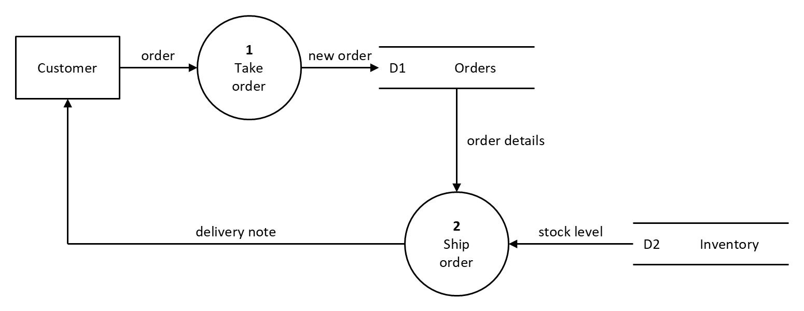
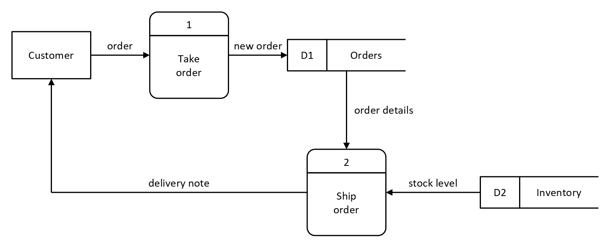
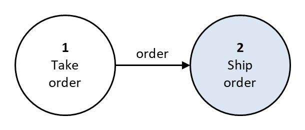
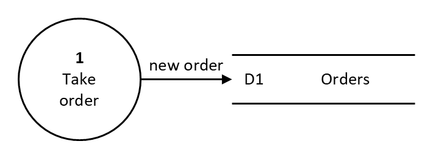
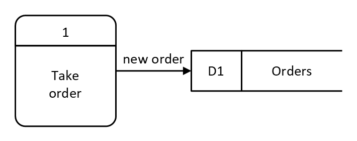
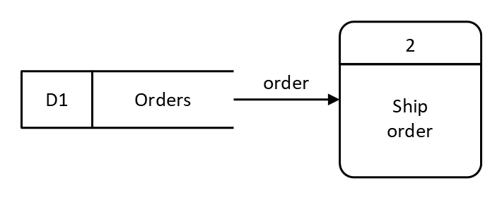
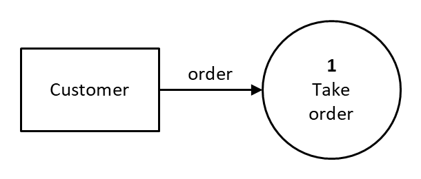

# Data flow diagrams

Macros for a data flow diagram's parts, in a file pikslide ships:
`include "dfd.pik"`, then a call draws each process, data store and
external entity, in DeMarco/Yourdon or Gane-Sarson notation; the flows
are arrows. `pikslide --help dfd` lists the macros, then gives a recipe
in each notation, and `pikslide --help NAME` describes one.

Written by `scripts/gen_dfd_gallery.py` from the recipes and each
macro's `--help` entry (`--png` to render the pictures, with
PowerPoint).

## DeMarco/Yourdon

A process is a numbered circle, `dfdprocess`, and a data store two parallel lines with its id and name between them, `dfdstore`. An external entity is a box, `dfdentity`, and a flow an arrow labeled with the data it carries. Order handling, as the recipe in `pikslide --help dfd` draws it, less its notes:

```pikslide
include "dfd.pik"

Customer: dfdentity("Customer")
arrow "order" above right 150%
Take: dfdprocess("1", "Take" "order")
arrow "new order" above right 150%
Orders: dfdstore("D1", "Orders")

Ship: dfdprocess("2", "Ship" "order") with .n at 1in below Orders.s
arrow "order details" ljust from Orders.s to Ship.n

Inventory: dfdstore("D2", "Inventory") with .w at 1.2in right of Ship.e
arrow "stock level" above from Inventory.w to Ship.e

line "delivery note" above from Ship.w left until even with Customer
arrow up to Customer.s
```



## Gane-Sarson

A process is a rounded rectangle with its number in a band at the top, `dfdgsprocess`, and a data store a rectangle open on its right with its id in a compartment of its own, `dfdgsstore`. An external entity is a box, `dfdentity`, and a flow an arrow labeled with the data it carries. Order handling, as the recipe in `pikslide --help dfd` draws it, less its notes:

```pikslide
include "dfd.pik"

Customer: dfdentity("Customer")
arrow "order" above right 150%
Take: dfdgsprocess("1", "Take" "order")
arrow "new order" above right 150%
Orders: dfdgsstore("D1", "Orders")

Ship: dfdgsprocess("2", "Ship" "order") with .n at 1in below Orders.s
arrow "order details" ljust from Orders.s to Ship.n

Inventory: dfdgsstore("D2", "Inventory") with .w at 1.2in right of Ship.e
arrow "stock level" above from Inventory.w to Ship.e

line "delivery note" above from Ship.w left until even with Customer
arrow up to Customer.s
```



## The macros

### `dfdprocess`

A process, DeMarco/Yourdon: a numbered circle. A circle dfdprocwid across, NUMBER in bold above NAME. Every process is that size, so break NAME into lines yourself, a string each ("Take" "order"): PowerPoint would wrap it where it chose, with a warning. NUMBER and NAME are the circle's strings and attributes. It's a circle, not a block: its edges are a circle's.

```pikslide
include "dfd.pik"
Take: dfdprocess("1", "Take" "order")
arrow "order" above right 150%
Ship: dfdprocess("2", "Ship" "order" fill accent1 lighter 80%)
```



### `dfdstore`

A data store, DeMarco/Yourdon: two parallel lines, its id and name between them. Two lines dfdstorewid long, dfdstoreht apart, ID at the left between them and NAME in the rest, where it wraps and warns as in a box. ID is a text's strings and attributes ("" for none), NAME an outlineless box's. The pieces: Upper, Lower, the lines, and Id, Name. .w and .e are its open ends, .n and .s the middle of its lines.

```pikslide
include "dfd.pik"
Take: dfdprocess("1", "Take" "order")
arrow "new order" above right 150%
Orders: dfdstore("D1", "Orders")
```



### `dfdgsprocess`

A process, Gane-Sarson: a rounded rectangle, its number at the top. A rounded rectangle dfdprocwid by dfdprocht, a band dfdnumht high across its top for NUMBER and NAME below it. Every process is that size, so break NAME into lines yourself, a string each ("Take" "order"). NUMBER and NAME are their shapes' strings and attributes. The pieces: Number, the band, and Name, the rest.

```pikslide
include "dfd.pik"
Take: dfdgsprocess("1", "Take" "order")
arrow "new order" above right 150%
Orders: dfdgsstore("D1", "Orders")
```



### `dfdgsstore`

A data store, Gane-Sarson: a rectangle open on its right, its id in a compartment. A rectangle dfdstorewid by dfdstoreht, open on its right: ID in a box dfdidwid wide at its left, NAME in the rest. ID and NAME are their boxes' strings and attributes, NAME's outlineless. The pieces: Id, Upper, Lower, the lines, and Name. .w is its closed end and .e its open one, .n and .s the middle of its lines.

```pikslide
include "dfd.pik"
Orders: dfdgsstore("D1", "Orders")
arrow "order" above right 150%
Ship: dfdgsprocess("2", "Ship" "order")
```



### `dfdentity`

An external entity: a box. A box dfdentitywid by dfdentityht, in either notation: where data comes from or goes to, outside the system. NAME is its strings and attributes: "Customer" fit sizes it to them.

```pikslide
include "dfd.pik"
Customer: dfdentity("Customer")
arrow "order" above right 150%
Take: dfdprocess("1", "Take" "order")
```


