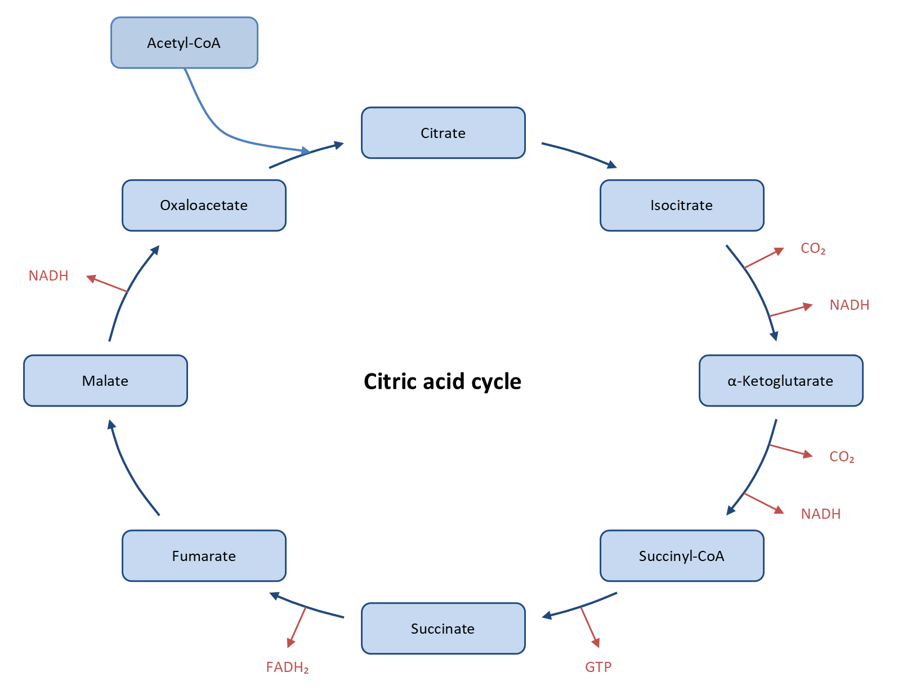

# The citric acid cycle

[citric-acid-cycle.pik](citric-acid-cycle.pik) was drawn by Claude Code: the prompt below, given
as it is to a new Claude Code session at the repository's root
(`claude -p`), in one run. That run checked it with `--check` and looked
at the pictures `--renderer direct` drew; [citric-acid-cycle.pptx](citric-acid-cycle.pptx) and
the PNG below were rendered afterwards, the PNG by PowerPoint.



## The prompt

```text
Draw a slide with pikslide: the citric acid cycle.

1. Its eight intermediates round a circle, clockwise from citrate at the
   top: citrate, isocitrate, α-ketoglutarate, succinyl-CoA, succinate,
   fumarate, malate and oxaloacetate, each joined to the next by an
   arrow along the circle.
2. Acetyl-CoA comes in from outside and joins oxaloacetate to make
   citrate.
3. Outside the circle, mark what a step gives off with a short arrow
   away from it: CO2 at isocitrate → α-ketoglutarate and at
   α-ketoglutarate → succinyl-CoA; NADH at those two and at malate →
   oxaloacetate; GTP at succinyl-CoA → succinate; FADH2 at succinate →
   fumarate.
4. Put "Citric acid cycle" in the middle.

Save the diagram as docs/examples/citric-acid-cycle.pik, and render it with
`uv run pikslide docs/examples/citric-acid-cycle.pik docs/examples/citric-acid-cycle.pptx --png --renderer direct`.

Start with `uv run pikslide --help llm`, and use `--help KEYWORD` for
anything else you need. Fix every warning `--check` gives. Look at the
PNG yourself before you finish: text that overlaps or overflows, arrows
that miss what they join, anything out of place. Fix it and render again.
```
