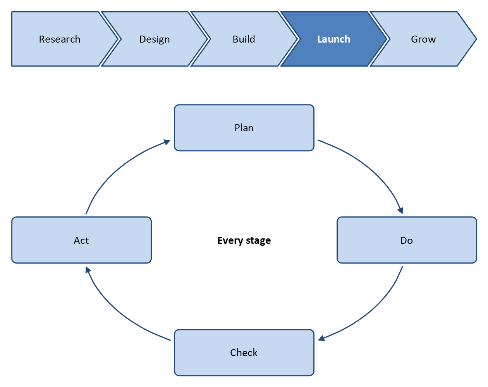

# Launching a new product

[product-launch.pik](product-launch.pik) was drawn by Claude Code: the prompt below, given
as it is to a new Claude Code session at the repository's root
(`claude -p`), in one run. That run checked it with `--check` and looked
at the pictures `--renderer direct` drew; [product-launch.pptx](product-launch.pptx) and
the PNG below were rendered afterwards, the PNG by PowerPoint.



## The prompt

```text
Draw a slide with pikslide: the plan for launching a new product.

1. Across the top, its stages as a row of chevrons: Research, Design,
   Build, Launch, Grow. Make Launch stand out from the others.
2. Below them, the cycle the team runs in every stage: Plan, Do, Check,
   Act, with "Every stage" in its middle.

Save the diagram as docs/examples/product-launch.pik, and render it with
`uv run pikslide docs/examples/product-launch.pik docs/examples/product-launch.pptx --png --renderer direct`.

Start with `uv run pikslide --help llm`, and use `--help KEYWORD` for
anything else you need. Fix every warning `--check` gives. Look at the
PNG yourself before you finish: text that overlaps or overflows, arrows
that miss what they join, anything out of place. Fix it and render again.
```
