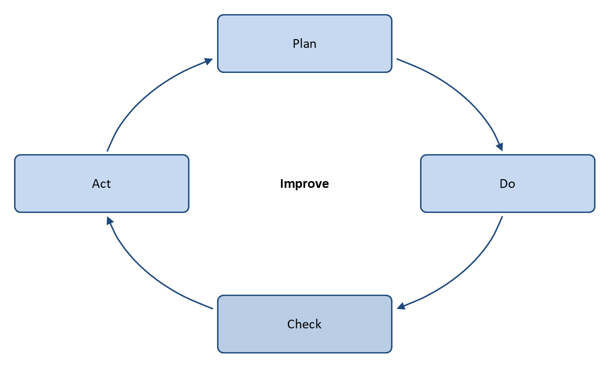
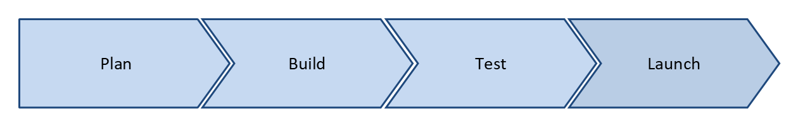
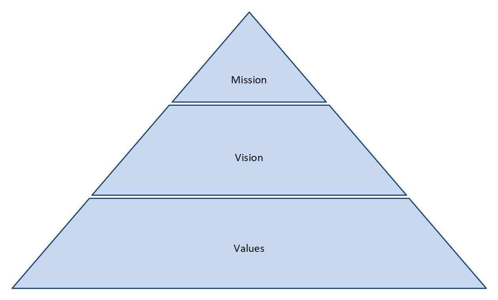
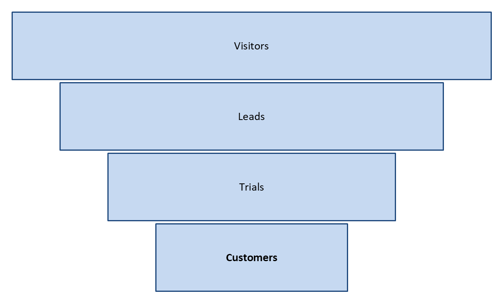
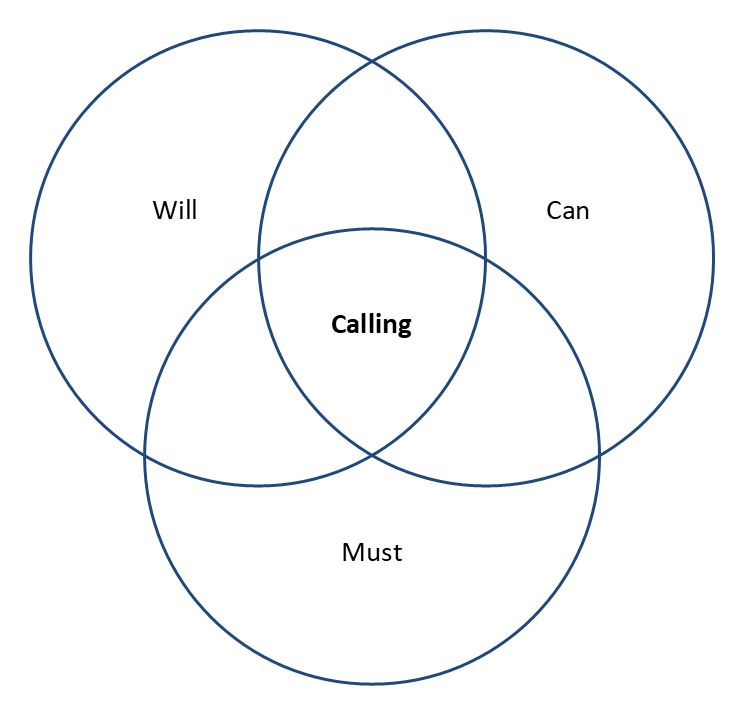
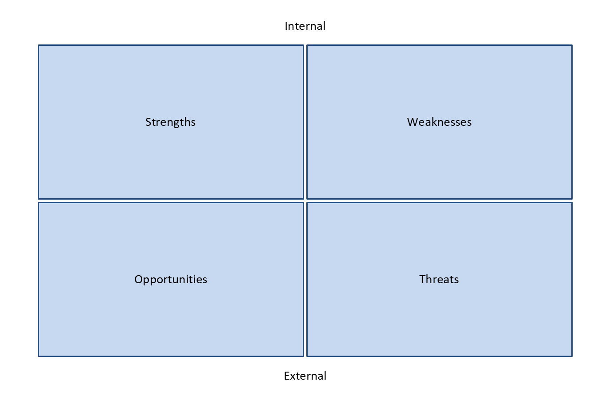
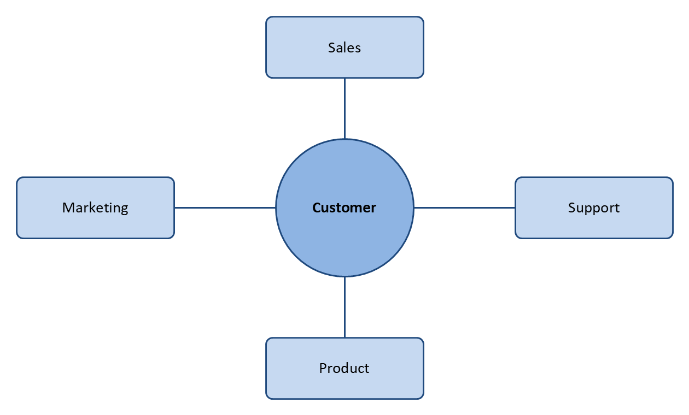

# Figures

Macros for diagrams whose shape is the point, in a file pikslide ships:
`include "figures.pik"`, then one call draws the figure. Each draws a
block whose parts are named in it (`P.S1`, `P.C`); each argument is a
part's strings and attributes, written last, so that they win. `figwid`
and `fight` are the size a figure fits in. `pikslide --help figures`
lists them, and `pikslide --help NAME` describes one.

Written by `scripts/gen_figure_gallery.py` from each family's
`--help` entry (`--png` to render the pictures, with PowerPoint).

## `cycle3` … `cycle6`

Steps round a circle, each joined to the next by an arrow. Three to six steps, the first at the top and the rest clockwise, each an arrow from the one before: PDCA, a feedback loop. Each STEP is its box's strings and attributes. The parts: S1 ... the steps, and C, the center, for a word in the middle.

```pikslide
include "figures.pik"
P: cycle4("Plan", "Do", "Check" fill emphasis lighter 60%, "Act")
text "Improve" bold at P.C
```



## `chevron3` … `chevron6`

Stages in a row of chevrons, left to right. Three to six stages, the first a pentagon and the rest chevrons, each fitting into the one before, as wide as figwid together and a fifth of fight high. Each STAGE is its shape's strings and attributes. The parts: S1 ... the stages.

```pikslide
include "figures.pik"
P: chevron4("Plan", "Build", "Test", "Launch" fill emphasis lighter 60%)
```



## `pyramid3` … `pyramid5`

Tiers of a pyramid, top to bottom. Three to five tiers of one triangle figwid wide at its base and fight high, the top tier a triangle and the rest trapezoids: a hierarchy, a mission, vision and values. The top tier is narrow: give it a word. Each TIER is its shape's strings and attributes. The parts: S1 ... the tiers, from the top.

```pikslide
include "figures.pik"
P: pyramid3("Mission", "Vision", "Values")
```



## `funnel3` … `funnel5`

Stages of a funnel, top to bottom. Three to five stages, each a box narrower than the one above, centered, from figwid wide at the top to four tenths of it at the bottom, fight high together. Each STAGE is its box's strings and attributes. The parts: S1 ... the stages, from the top.

```pikslide
include "figures.pik"
P: funnel4("Visitors", "Leads", "Trials", "Customers" bold)
```



## `venn2` … `venn3`

Two or three overlapping circles, with a word where they all overlap. Two circles side by side, or three in a triangle, the first at the left (top left), as big as figwid and fight allow. Each NAME is a text's strings and attributes, in its circle's own part; OVERLAP is the text where all of them overlap. The parts: S1 ... the circles, T1 ... their names, and C, the overlap's text.

```pikslide
include "figures.pik"
P: venn3("Will", "Can", "Must", "Calling" bold)
```



## `matrix2`

A two-by-two matrix, with words at the ends of its axes. Four boxes in two rows, figwid by fight together, and the axes' words outside them: LEFT and RIGHT at the ends of the horizontal one, BOTTOM and TOP of the vertical one. Leave an axis's words out ("") and it has none. Each argument is its box's or text's strings and attributes. The parts: S1 ... S4 the boxes, in reading order, and L, R, B, T the words.

```pikslide
include "figures.pik"
P: matrix2("Strengths", "Weaknesses", "Opportunities", "Threats", "", "", "External", "Internal")
```



## `hub3` … `hub8`

A center joined to the items round it. A circle in the center, and three to eight items round it, the first at the top and the rest clockwise, each joined to it by a line. CENTER is the circle's strings and attributes, and each ITEM its box's. The parts: C, the center, and S1 ... the items.

```pikslide
include "figures.pik"
P: hub4("Customer" bold, "Sales", "Support", "Product", "Marketing")
```


