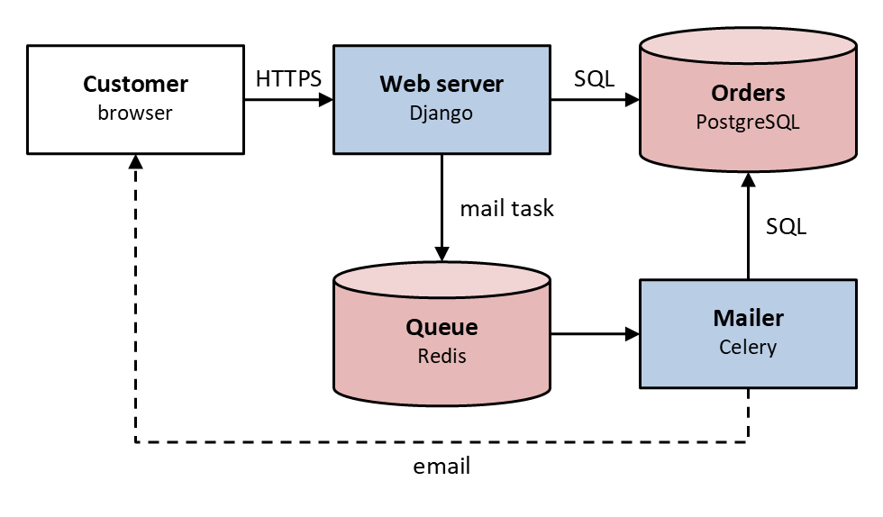
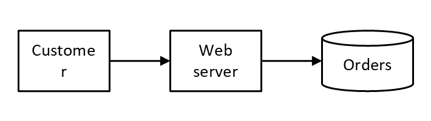
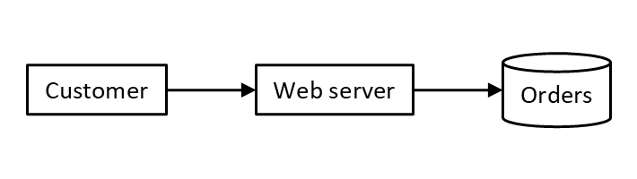
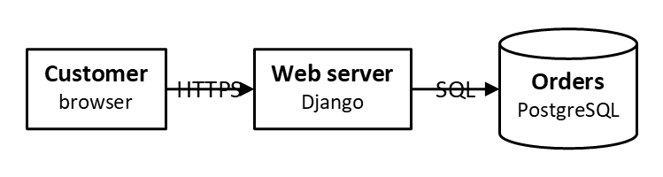
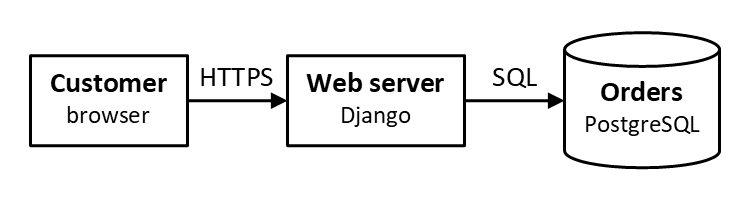
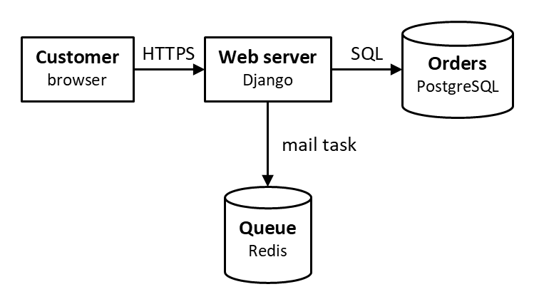
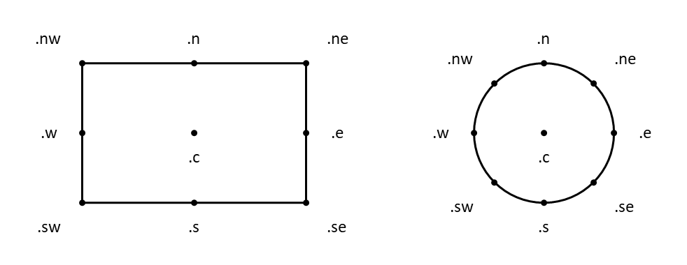
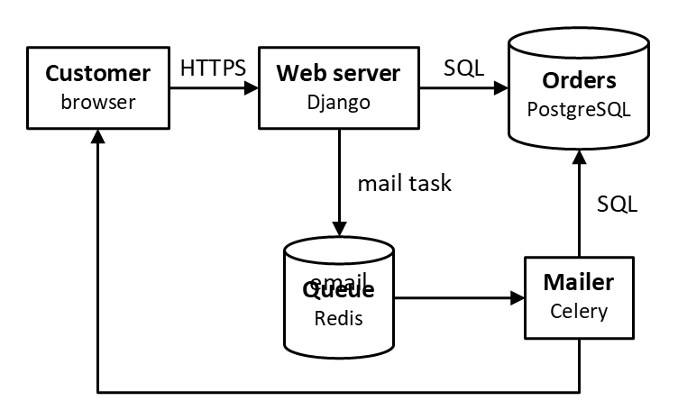
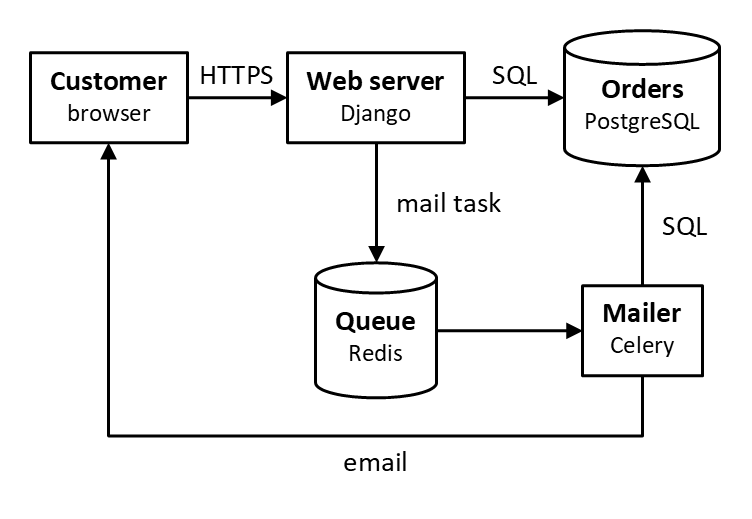
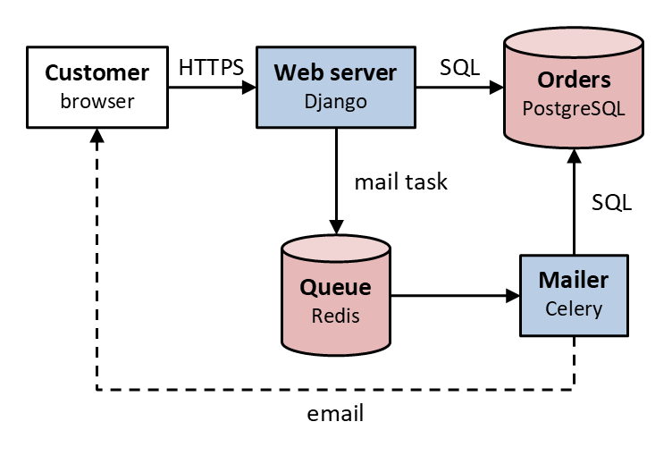

# Tutorial

This tutorial draws one diagram, a web shop taking an order, in six
steps. Each step adds one idea to the one before, and each is a whole
`.pik` file, shown with the picture it renders to:



Along the way, pikslide warns about what's wrong with a first try, and
the steps fix it as the warnings say. That's how a diagram gets
finished, by you or by an LLM: write, render, read the warnings, fix.

It's as much for reading a `.pik` as for writing one: one an LLM wrote
for you, to see what each line does and change it yourself.
`pikslide --help intro` has the same language in one page of text.

## Before you start

Install pikslide (see the [README](../../README.md#install)). Save a
step as a file, say `step1.pik`, and render it:

```sh
pikslide step1.pik step1.pptx --png
```

That writes `step1.pptx`, a deck of one slide sized to the diagram, and
`step1.png`, drawn by PowerPoint, or by LibreOffice where there's no
PowerPoint. Every shape in the `.pptx` can be selected, moved and
restyled. The pictures here are PowerPoint's.

## 1. One object after another

A first try, [step1-warns.pik](step1-warns.pik):

```pikslide
box "Customer"
arrow
box "Web server"
arrow
cylinder "Orders"
```

One object a line. Each goes after the one before, edge to edge, in the
current direction: right, to start with. An arrow starts where the
object before it ends. There are no coordinates to work out.

`box`, `cylinder` and `arrow` are classes; `pikslide --help classes`
lists them all, and `shape NAME` draws any of PowerPoint's preset shapes
([shapes.md](../shapes.md)). A `down` on a line of its own makes the
objects after it chain downward, and `left` and `up` work the same way.

Render it, and pikslide warns:

```text
$ pikslide step1-warns.pik step1-warns.pptx
warning: box "Customer": text overflows the usable width (0.57 in > 0.55 in) and will wrap; widen it, reduce margin, or use fit
warning: box "Web server": text overflows the usable width (0.68 in > 0.55 in) and will wrap; widen it, reduce margin, or use fit
warning: no --template given: colors and fonts are stand-ins from the built-in Office theme (pikslide --help template)
wrote step1-warns.pptx
```



A box is 0.75in by 0.5in, and neither name fits in it: PowerPoint wraps
them, `Customer` in the middle of the word. A warning says what's wrong
and what to do, and here `fit` does it: it makes an object just big
enough for its text.

The last warning is about the run, not the diagram. With no
`--template`, the deck is in the built-in Office theme; that's fine
while you're trying things, so leave it.

[step1.pik](step1.pik):

```pikslide
box "Customer" fit
arrow
box "Web server" fit
arrow
cylinder "Orders" fit
```



## 2. Text

A first try, [step2-warns.pik](step2-warns.pik):

```pikslide
box "Customer" bold "browser" small fit
arrow "HTTPS"
box "Web server" bold "Django" small fit
arrow "SQL"
cylinder "Orders" bold "PostgreSQL" small fit
```

Each string is a line of text, top to bottom. A flag such as `bold` or
`small` belongs to the string right before it (`pikslide --help flags`
lists them), so each part is its name in bold over its role in small
text. The object's own attributes, like `fit`, can go before, between or
after the strings.

A line's strings sit at its middle, and with no flag, on the line
itself:

```text
$ pikslide step2-warns.pik step2-warns.pptx
warning: arrow 1's label "HTTPS" is on the line itself: make it above or below, or beside a vertical line, ljust or rjust
warning: arrow 2's label "SQL" is on the line itself: make it above or below, or beside a vertical line, ljust or rjust
warning: no --template given: colors and fonts are stand-ins from the built-in Office theme (pikslide --help template)
wrote step2-warns.pptx
```



The arrows have no names of their own yet, so the warnings call them
`arrow 1` and `arrow 2`, the first and second arrows. These are level
lines, so `above` it is.

[step2.pik](step2.pik):

```pikslide
box "Customer" bold "browser" small fit
arrow "HTTPS" above
box "Web server" bold "Django" small fit
arrow "SQL" above
cylinder "Orders" bold "PostgreSQL" small fit
```



## 3. Names and places

[step3.pik](step3.pik):

```pikslide
Customer: box "Customer" bold "browser" small fit
arrow "HTTPS" above
Web: box "Web server" bold "Django" small fit
arrow "SQL" above
DB: cylinder "Orders" bold "PostgreSQL" small fit

Queue: cylinder "Queue" bold "Redis" small fit with .n at 0.6in below Web.s
arrow "mail task" ljust from Web.s to Queue.n
```



`Web:` gives the box a name, starting with a capital letter, for later
lines to refer to. In the `.pptx`, the shape is named `Web` too, and a
warning about it calls it `Web`, so you, or an LLM reading either, can
tell which shape is which.

With its name, a line can refer to a point on the object: `Web.s` is the
middle of its bottom edge.



`with .n at 0.6in below Web.s` places the queue by its top edge, `.n`,
at the point 0.6in below the web server's bottom: the queue hangs under
it. `at P` alone would put the queue's center at P. An object placed
like this doesn't end the chain: the next one with no place of its own
still goes after the one before it, wherever that went.

`arrow from Web.s to Queue.n` draws a line between two points. `ljust`
puts an upright line's label on its right, and `rjust` on its left.

## 4. Lines that turn

A first try, [step4-warns.pik](step4-warns.pik):

```pikslide
Customer: box "Customer" bold "browser" small fit
arrow "HTTPS" above
Web: box "Web server" bold "Django" small fit
arrow "SQL" above
DB: cylinder "Orders" bold "PostgreSQL" small fit

Queue: cylinder "Queue" bold "Redis" small fit with .n at 0.6in below Web.s
arrow "mail task" ljust from Web.s to Queue.n
Mailer: box "Mailer" bold "Celery" small fit at (DB.x, Queue.y)
arrow from Queue.e to Mailer.w
arrow "SQL" ljust from Mailer.n to DB.s
arrow "email" below from Mailer.s down 0.3in then left until even with Customer then to Customer.s
```

`at (DB.x, Queue.y)` makes a point from two objects' coordinates: the
x of Orders and the y of Queue. The mailer goes under the database, level
with the queue, so the arrows to both are straight. Lay a diagram out so
its lines run straight, and bend one only where it has to go round
something.

The last arrow does: it goes round under the queue, back to the
customer. Each `then` starts a new segment. `down 0.3in` goes down from
the mailer's bottom. `left until even with Customer` goes left until it's
level with the customer, under its middle. `to Customer.s` goes straight
up to its bottom.

```text
$ pikslide step4-warns.pik step4-warns.pptx
warning: text on text: Queue's text "Queue" and arrow 6's label "email"
warning: arrow 6's label "email" is off the line, at the middle of the box round it: label a straight line instead, or place the text as an object of its own
warning: no --template given: colors and fonts are stand-ins from the built-in Office theme (pikslide --help template)
wrote step4-warns.pptx
```



A line's label goes at the middle of the box round the line. For a
straight line that's on the line; for this one, it's on none of its
segments, and on top of the queue. The warning gives two ways out. To
label a straight line instead, draw the bend in pieces, as the
[DFD recipe](../cookbook/dfd.md) does. Here the label goes as a text of
its own: name the arrow `Mail`, and put the text under it.

[step4.pik](step4.pik):

```pikslide
Customer: box "Customer" bold "browser" small fit
arrow "HTTPS" above
Web: box "Web server" bold "Django" small fit
arrow "SQL" above
DB: cylinder "Orders" bold "PostgreSQL" small fit

Queue: cylinder "Queue" bold "Redis" small fit with .n at 0.6in below Web.s
arrow "mail task" ljust from Web.s to Queue.n
Mailer: box "Mailer" bold "Celery" small fit at (DB.x, Queue.y)
arrow from Queue.e to Mailer.w
arrow "SQL" ljust from Mailer.n to DB.s
Mail: arrow from Mailer.s down 0.3in then left until even with Customer then to Customer.s
"email" below at Mail.s
```



A line has the same points as a box: those of the box round it. The
arrow's lowest segment runs the whole width of that box, so `Mail.s`,
the middle of its bottom, is the middle of that segment. A string on a
line of its own is a text object; `below` puts it under the point it's
at.

Or let PowerPoint route the arrow:

```
Mail: arrow from Mailer.s to Customer.s attach path elbow
```

`attach` writes the arrow as a connector, and `path elbow` has
PowerPoint route it at right angles, much as above. Its ends stay on the
mailer and the customer when someone moves either of them in PowerPoint.
A line without `attach` stays where the `.pik` drew it.

To draw a straight line on a slant, `arrow from A to B chop` joins two
objects' centers, cut short at their outlines.

## 5. Color and line style

[step5.pik](step5.pik):

```pikslide
Customer: box "Customer" bold "browser" small fit
arrow "HTTPS" above
Web: box "Web server" bold "Django" small fill accent1 lighter 60% fit
arrow "SQL" above
DB: cylinder "Orders" bold "PostgreSQL" small fill accent2 lighter 60% fit

Queue: cylinder "Queue" bold "Redis" small fill accent2 lighter 60% fit with .n at 0.6in below Web.s
arrow "mail task" ljust from Web.s to Queue.n
Mailer: box "Mailer" bold "Celery" small fill accent1 lighter 60% fit at (DB.x, Queue.y)
arrow from Queue.e to Mailer.w
arrow "SQL" ljust from Mailer.n to DB.s
Mail: arrow from Mailer.s down 0.3in then left until even with Customer then to Customer.s stroke dashed
"email" below at Mail.s
```



`fill accent1 lighter 60%` fills a shape with a theme color, 60%
lighter. `accent1` to `accent6`, `text1`, `text2`, `bg1` and `bg2` are
the slots of the deck's theme. Drawn with `--template corporate.potx`,
they're your template's colors (`pikslide --help template`). A named
color such as `steelblue` stays the same whatever the template.
`lighter N%` and `darker N%` work on either kind. Here the programs are
`accent1` and the stores `accent2`: one color for each kind of part.

`stroke dashed` changes how the line is drawn. `stroke` takes a color,
then any of `thick`, `thin`, `dashed`, `dotted`, `solid` or `invis`, as
in `box stroke accent2 thick`. The dashed arrow is the email, sent after
the order is taken, not in reply to the request.

## 6. Sizes and repeats

[step6.pik](step6.pik):

```pikslide
# A web shop's orders: the web server saves an order and queues a mail
# task, and the mailer sends the customer an email about it later.

boxwid = 1.2in
boxht = 0.6in
cylwid = 1.2in
cylht = 0.8in

define program { box $1 bold $2 small fill accent1 lighter 60% }
define store { cylinder $1 bold $2 small fill accent2 lighter 60% }

Customer: box "Customer" bold "browser" small
arrow "HTTPS" above
Web: program("Web server", "Django")
arrow "SQL" above
DB: store("Orders", "PostgreSQL")

Queue: store("Queue", "Redis") with .n at 0.6in below Web.s
arrow "mail task" ljust from Web.s to Queue.n
Mailer: program("Mailer", "Celery") at (DB.x, Queue.y)
arrow from Queue.e to Mailer.w
arrow "SQL" ljust from Mailer.n to DB.s
Mail: arrow from Mailer.s down 0.3in then left until even with Customer then to Customer.s stroke dashed
"email" below at Mail.s
```


`boxwid = 1.2in` sets a variable: the width of a box that doesn't give
its own. `boxht`, `cylwid` and `cylht` are the same for a box's height
and a cylinder's size. `pikslide --help variables` lists them all, with
their defaults. With `fit` gone, every box is one size, and so is every
cylinder, so the parts line up. `fit` gives each part a size of its own;
set the sizes when the parts are a set.

`define program { ... }` makes a macro. A call, `program("Web server",
"Django")`, is replaced by its body, with `$1` and `$2` the arguments. A
call can have a name, `Web: program(...)`, and attributes after it, such
as `at` or `with`. What a program looks like is now written once: change
its fill there, and both programs change.

`#` starts a comment, to the end of the line. Say at the top what the
diagram shows, for the next person, or the next LLM, to change it.

## When pikslide warns

A warning names the objects it's about, says what's wrong, and most
often what to do. There are three ways to answer one:

- **Fix the source**, as steps 1, 2 and 4 do. Most warnings are this
  kind.
- **Say it's meant.** Two objects that overlap on purpose don't warn if
  one is drawn `behind` the other, or wholly inside it: a frame round a
  group, as the [architecture recipe](../cookbook/architecture.md)
  draws, or a dot on an outline, as in the picture of points above.
- **Leave it, knowing why.** The `--template` warning, while you're
  trying things out. When the deck has to be right, `--strict` makes it
  an error.

`pikslide x.pik --check` lays a diagram out and writes nothing: the
errors, the warnings and where each object went, as JSON, each warning
with the names of its objects. An LLM can fix a diagram from that and
check again, without looking at the picture.

## Where next

- `pikslide --help WORD` for any word here (`--help then`,
  `--help fill`). `pikslide --help keywords` lists them all.
- The [cookbook](../cookbook/): data flow diagrams, flowcharts and
  system architecture, to copy and adapt.
- Drawing with an LLM: the [README](../../README.md), and
  [japan-capitals.md](../examples/japan-capitals.md), a slide Claude Code
  drew from one prompt.

---

The steps are `stepN.pik` beside this page, each with its `stepN.png`,
and the first tries `stepN-warns.pik`. `tests/test_docs.py` checks this
page shows each `.pik` as it is, and that each run shown prints what it
shows, but for the overflow's measurements, which depend on the fonts
installed. `tests/test_overlap.py` checks that the steps themselves draw
with no warnings. To render the PNGs, with PowerPoint:

```sh
for f in docs/tutorial/*.pik; do
  uv run pikslide "$f" "/tmp/$(basename "${f%.pik}").pptx" --png "${f%.pik}.png" --renderer powerpoint
done
```
